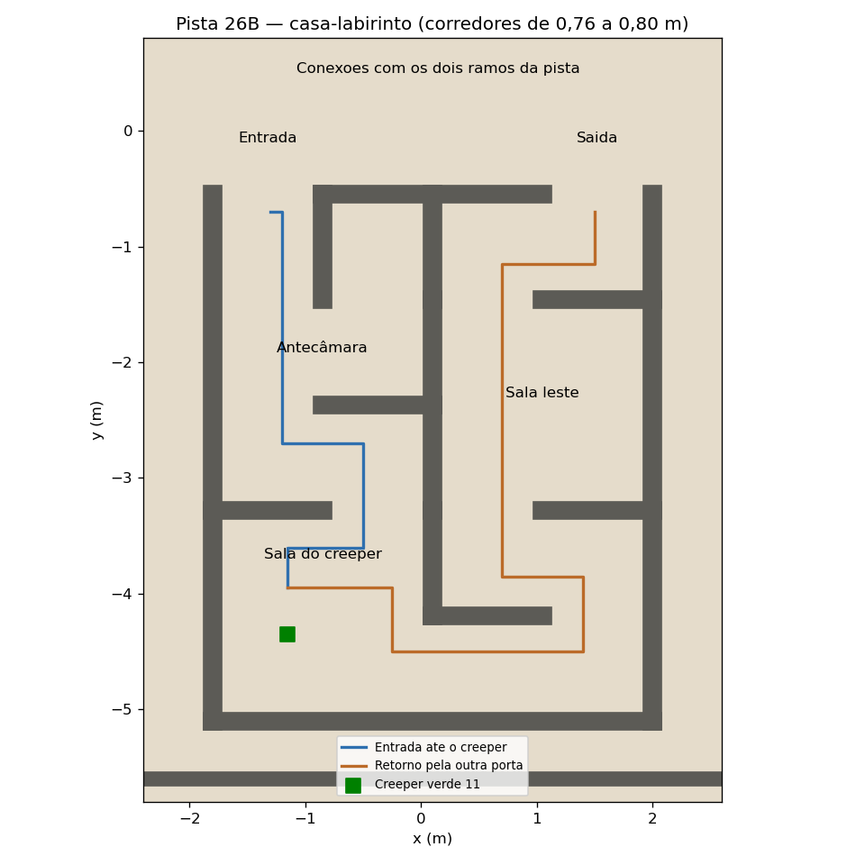

# my_simulation
Este repositoirio contem as simulacoes das aulas de robotica do INSPER.
.

### Pista 26B

Baseada na pista 25B, substitui as caixas vermelha e azul por uma casa sem teto,
com salas e corredores em labirinto. A casa mede 3,8 × 4,55 m, tem paredes de
0,75 m de altura e 0,15 m de espessura. Os corredores têm 0,76 a 0,80 m livres,
na faixa das passagens do mapa `labirinto` (aproximadamente 0,75 a 0,85 m).
A parede sul do entorno foi recuada para `y = -5,6 m`, com extensão do piso.

A entrada em `(-1,325; -0,55)` e a saída em `(1,525; -0,55)` conectam os dois
ramos inferiores da pista. O percurso tem curvas, uma antecâmara com um beco
para exploração e duas salas maiores. O creeper verde 11 fica na sala dos fundos
à esquerda, em `(-1,15; -4,35)`. Para sair pela outra porta, o robô contorna a
divisória central pelo corredor dos fundos e atravessa a sala leste. As mesas e
as placas de animais e da bicicleta foram removidas.

Após compilar o pacote e carregar o ambiente do workspace:

```bash
ros2 launch my_gazebo pista-26B.launch.py
```


